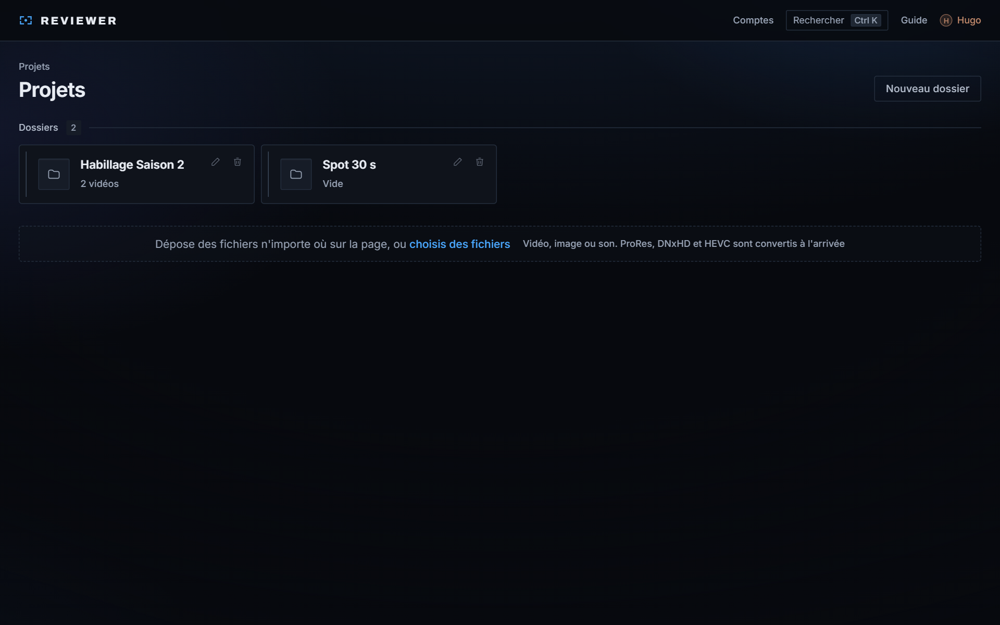
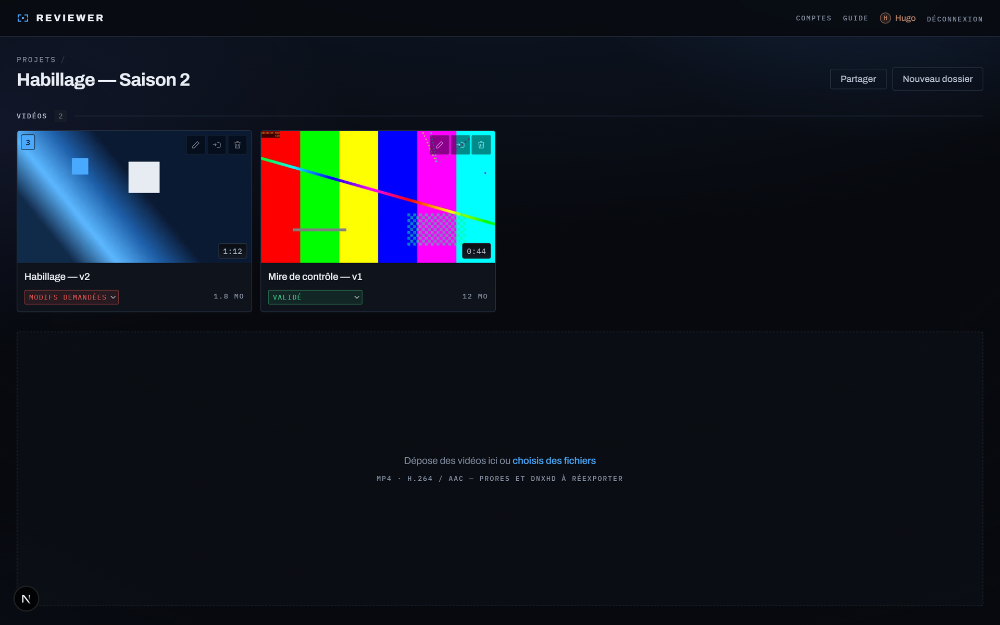
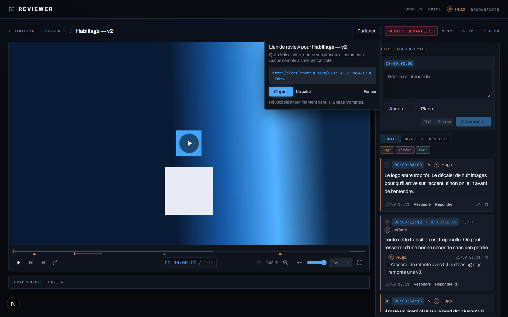
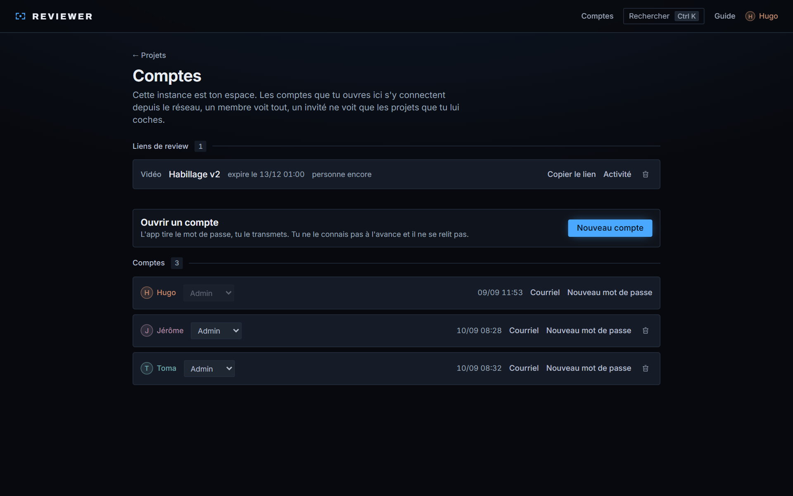

# Reviewer

Review vidéo au timecode, auto-hébergée. On dépose un montage, on le lit dans
le navigateur, et on commente **à l'image près**, avec des flèches et des
cadres dessinés directement sur l'image quand une phrase ne suffit pas.

Puis on envoie un lien au client. Il clique, donne son prénom, commente. Pas de
compte à créer, pas de mot de passe, et il ne voit que ce qu'on lui a ouvert.

Pas de service tiers, pas d'abonnement, pas de fichier qui sort de chez toi :
tout tourne sur une machine que tu contrôles. Sous licence MIT.

> L'interface est **en français uniquement**, elle n'est pas traduite. Voir
> [Limites connues](#limites-connues).


<sub>Les vidéos de ces captures sont des mires générées pour la démonstration
aucun contenu client.</sub>

## Ce que ça fait

- **Commentaires au timecode.** Chaque note est attachée à une image précise,
  ou à un intervalle qu'on trace à la souris sur la piste.
- **Annotations sur l'image.** Point, flèche, cadre, tracé libre, rejoués au
  timecode de la note, à la couleur de leur auteur.
- **Fils de discussion.** On répond sous la note d'un autre au lieu d'en
  écrire une seconde au même endroit.
- **Versions.** v1, v2, v3 d'un même montage sur une seule vignette, chacune
  avec ses notes, et une comparaison synchronisée, côte à côte ou en volet.
- **Export des notes.** En marqueurs pour DaVinci Resolve (EDL), en CSV, ou en
  texte à coller dans un message.
- **En direct.** Les notes des autres arrivent sans recharger, et on voit qui
  regarde la vidéo en même temps.
- **Trois rôles.** Admin, membre, invité. Un invité ne voit que les projets
  qu'on lui ouvre.
- **Liens de review.** Un lien par vidéo ou par projet, avec expiration, à
  envoyer par le canal de son choix.
- **Lecteur d'outil vidéo.** Avance image par image, timecode `HH:MM:SS:FF`,
  zoom, aperçu au survol de la piste, raccourcis clavier.
- **ProRes, DNxHD, HEVC acceptés** : ce que le navigateur ne lit pas est
  converti en H.264 à l'arrivée, au lieu d'une vidéo noire découverte trois
  jours plus tard.
- **Envoi qui reprend.** Une coupure ne fait plus recommencer un rush : l'envoi
  repart d'où il s'était arrêté.
- **Recherche.** Ctrl + K, trois lettres, Entrée : n'importe quel projet ou
  montage, depuis n'importe quelle page.

## En images

| | |
|---|---|
|  |  |
| **Les projets.** Dossiers imbriqués sans limite. | **Un projet.** Statut, durée et notes ouvertes sur la vignette. |
|  |  |
| **Partager.** Un lien, une durée, et c'est envoyé. | **Les comptes.** Rôles, projets ouverts, liens actifs. |

## Installation

Il faut **Node 22.18 ou plus** : les scripts et les tests exécutent le
TypeScript directement. Rien d'autre : ffmpeg et SQLite sont embarqués.

```bash
git clone https://github.com/Larivs/reviewer.git
cd reviewer
npm install
npm run serve
```

Puis ouvrir l'adresse affichée au démarrage. **Au premier lancement, l'app
propose de créer le compte administrateur**, c'est toi. Cette page ne
s'affiche que tant qu'aucun compte n'existe, et disparaît dès que le premier
est créé.

`npm run serve` est le mode **production**, celui dans lequel l'app doit
tourner dès qu'une autre personne s'y connecte. Sur Windows, un double-clic sur
`Reviewer.cmd` fait la même chose et laisse la fenêtre ouverte.

Le script fait trois choses que `next start` ne fait pas, et ce sont les trois
qu'on oublie au mauvais moment :

- il **refuse de démarrer** si l'authentification est débrayée, la fenêtre se
  ferme sur un refus, pas sur un avertissement de plus ;
- il **recompile** si le code a changé depuis le dernier build, au lieu de
  servir sans rien dire une version périmée ;
- il affiche **les adresses à donner aux autres**, l'IP du réseau local et
  celle du VPN s'il y en a un. `next start` annonce `http://0.0.0.0:3000`, qui
  ne s'ouvre sur aucune machine.

`npm run dev` reste pour le développement : rechargement à chaud, mais lent au
premier affichage de chaque page et sans les optimisations. Ne pas le laisser
tourner pour une vraie session de review.

### Configuration

Tout est optionnel. Copier `.env.example` en `.env.local` pour changer quelque
chose, le fuseau horaire d'affichage, par exemple, qui vaut `Europe/Paris`
par défaut.

## Qui voit quoi

Une instance = un espace. Chacun fait tourner la sienne : si deux studios
travaillent ensemble, chacun héberge la sienne et invite l'autre chez lui.

| Rôle | Voit | Peut |
|---|---|---|
| **admin** | tout l'espace | gérer les comptes et les liens |
| **membre** | tout l'espace | déposer, commenter, résoudre |
| **invité** | seulement les projets qu'on lui ouvre | commenter, répondre, résoudre |

L'admin ouvre les comptes depuis la page **Comptes**. Il ne choisit pas les
mots de passe : l'app en tire un, l'affiche **une seule fois**, et ne le
remontre jamais. Il n'existe en clair nulle part, pas même pour celui qui
crée le compte.

### Les liens de review

Pour un client, un compte est déjà trop. Le bouton **Partager**, sur une vidéo
ou sur un projet, produit un lien à envoyer :

```
https://ton-serveur/r/KT2E-QEF7-26XX-ZU93-4UD3
```

Qui l'ouvre donne son prénom, pour signer ses notes, pas pour s'identifier -
et commente immédiatement. Le lien porte une date d'expiration choisie à sa
création, et se ferme d'un clic depuis la page Comptes.

**La contrepartie est assumée : qui détient le lien entre.** C'est le même
compromis que partout ailleurs, et c'est ce qui rend l'expiration importante.
Elle est vérifiée à chaque affichage, pas seulement à l'ouverture du lien : un
accès ouvert se referme au moment où le lien meurt, sans attendre que le
cookie expire.

Un droit ouvert par un lien reste **attaché à ce lien** : il se referme avec
lui pour tous ceux qui sont entrés par là, y compris un invité déjà connu
d'un autre lien.

Fermer un lien retire les droits et coupe les sessions, mais **ne supprime ni
les comptes ni leurs notes** : effacer la review d'un client parce qu'on
révoque un accès serait une perte de travail, pas une mesure de sécurité.

## Accès depuis un autre poste

Le serveur écoute sur toutes les interfaces, et `npm run serve` affiche les
adresses à recopier au démarrage. Depuis le même réseau, les autres postes
ouvrent `http://<ip-du-serveur>:3000`.

### Le pare-feu Windows

Windows demande une autorisation la première fois qu'un programme écoute sur
le réseau, et la boîte de dialogue ne coche par défaut que le profil du réseau
courant. Changer de réseau, passer du bureau à la maison, ou d'un Wi-Fi
« public » à un « privé », suffit donc à rendre le serveur injoignable sans
qu'aucune erreur n'apparaisse : les autres postes voient juste une page qui ne
charge pas.

Une règle explicite sur le port, valable pour les deux profils, évite ce
diagnostic pénible. À passer **une fois**, dans un PowerShell **administrateur** :

```powershell
New-NetFirewallRule -DisplayName "Reviewer (port 3000)" -Direction Inbound -Protocol TCP -LocalPort 3000 -Action Allow -Profile Private,Public
```

### Depuis l'extérieur

Trois façons, par ordre de préférence.

**Un VPN vers le réseau du serveur.** Rien n'est exposé sur Internet, et le
trafic est chiffré de bout en bout : le HTTP simple de l'app ne circule jamais
en clair. C'est ce qu'on fait ici, avec le « VPN nomade » d'une Livebox Pro -
L2TP/IPsec à clé partagée, que Windows et macOS ouvrent sans rien installer.

**Un réseau maillé** type Tailscale ou ZeroTier. Simple à mettre en place,
mais leur offre gratuite est **réservée à l'usage non commercial** : un studio
doit passer au plan payant.

**Un reverse proxy en HTTPS** (Caddy, nginx, Traefik) si l'instance doit être
publique, le cas dès qu'on envoie des liens de review à des clients qui ne
sont pas sur le VPN. Le cookie de session passe alors automatiquement en
`secure` : l'app détecte `x-forwarded-proto`, il n'y a rien à régler.

> Un flux d'événements (`/api/events`) pousse les changements en direct.
> Derrière nginx, il lui faut `proxy_buffering off` sur cette route, sinon les
> notes des autres n'arrivent qu'au retour sur l'onglet. Caddy et Traefik ne
> demandent rien.

L'envoi part par tranches de 32 Mo : il passe donc aussi par les tunnels qui
plafonnent la taille d'une requête, Cloudflare Tunnel et ses 100 Mo compris.

**Ne jamais ouvrir le port 3000 directement sur Internet** : l'app parle HTTP,
le mot de passe circulerait en clair.

### L'adresse du poste hôte doit être fixe

Sans réservation, la box redistribue les adresses à son idée. Constaté le
10 septembre 2026 sur le poste de développement : `192.168.1.138` la veille,
`192.168.1.15` le lendemain, et l'ancienne adresse ne répondait plus. Tous
les favoris cassent d'un coup. Dans l'interface de la box, réserver une IP
pour le poste hôte (bail DHCP statique) règle ça une fois pour toutes.

### La machine ne doit pas s'endormir

Le poste qui sert l'app est le serveur. Réglé par défaut à **15 minutes**
d'inactivité sur secteur, il se met en veille et emporte le serveur avec lui -
sans erreur côté client, juste une page qui ne charge plus. Et comme c'est
l'inactivité du *clavier* qui compte, pas celle du réseau, ça arrive
précisément pendant que les autres regardent une vidéo.

À passer avant une session, puis à remettre après :

```powershell
powercfg /change standby-timeout-ac 0     # ne plus s'endormir sur secteur
powercfg /change standby-timeout-ac 15    # remettre le réglage d'origine
```

L'écran peut s'éteindre, lui : ça n'endort pas la machine.

## Avant d'ouvrir l'app aux autres

Une liste courte, dans l'ordre :

1. `npm run backup`, un point de retour avant la première vraie session.
2. Vérifier que `.env.local` ne porte pas `AUTH_DISABLED=1`.
3. `npm run serve`, puis ouvrir l'adresse réseau **depuis un autre poste** :
   c'est le seul test qui prouve que le pare-feu laisse passer.
4. Créer un lien de review et l'ouvrir dans une fenêtre privée, c'est le seul
   test qui prouve que le client verra bien quelque chose.

## Où sont les données

Tout est dans `data/`, ignoré par git :

- `data/reviewer.db`, comptes, dossiers, vidéos, commentaires (SQLite)
- `data/videos/`, les fichiers vidéo
- `data/thumbs/`, les vignettes générées
- `data/sprites/`, les planches d'aperçu au survol

Il n'y a pas de dossier de migrations : le schéma est appliqué au démarrage,
de façon idempotente, et les colonnes ajoutées après coup passent par un
`ALTER` explicite. Mettre à jour, c'est `git pull && npm install && npm run
serve`, la base se met à niveau toute seule.

### Sauvegarde

```bash
npm run backup                    # vers ../reviewer-backups
npm run backup -- D:/sauvegardes  # ailleurs, un disque externe par exemple
```

**Une copie manuelle de `data/` ne suffit pas** pendant que le serveur tourne.
La base est en mode WAL : des transactions validées vivent dans
`reviewer.db-wal` et ne rejoignent le `.db` qu'au prochain point de contrôle.
Copier `reviewer.db` seul perd donc les notes les plus récentes, sans rien
signaler, ce qui est le pire cas.

Le script prend un instantané cohérent par l'API `backup()` de SQLite, sans
arrêter le serveur, puis lance un `integrity_check` **sur la copie** : une
sauvegarde qu'on n'a jamais vérifiée n'est pas une sauvegarde. Les média,
immuables une fois écrits, ne sont recopiés que s'ils manquent à destination -
la seconde exécution copie zéro octet. Il signale au passage les vidéos
référencées en base dont le fichier a disparu du disque.

Aucune purge automatique des anciens instantanés : effacer des sauvegardes de
sa propre initiative est le genre de zèle qui se paie cher un jour.

**Restaurer** : arrêter le serveur, remplacer `data/reviewer.db` par
l'instantané voulu **renommé** `reviewer.db`, supprimer `reviewer.db-wal` et
`reviewer.db-shm` s'ils existent, l'instantané est complet, un journal d'une
autre époque le corromprait, puis recopier les média depuis le miroir.

## Formats vidéo

Le navigateur ne lit que certains codecs. À l'envoi, le fichier est analysé
par ffprobe, sur son **contenu** et pas sur son extension : un `.mp4` qui
contient du ProRes est reconnu pour ce qu'il est.

Lu tel quel : conteneur MP4/MOV/WebM, vidéo en H.264, VP8, VP9 ou AV1, audio
en AAC, MP3, Opus, Vorbis ou FLAC.

Tout le reste (ProRes, DNxHD, HEVC, MPEG-2, audio PCM ou AC-3) est **converti
en H.264 / AAC** après l'envoi. La vidéo apparaît tout de suite, marquée « en
conversion », et s'ouvre d'elle-même quand la copie est prête. Deux choses à
savoir :

- c'est un **proxy de review**, pas un master : l'original n'est pas conservé
  une fois la copie produite ;
- la conversion occupe le processeur de la machine hôte, une vidéo à la fois.
  Un long métrage en ProRes prend plusieurs minutes.

Un fichier sans piste vidéo, ou illisible, reste refusé.

### Note Windows

Les binaires ffmpeg embarqués sont soumis à la limite de 260 caractères des
chemins Windows. Les fichiers de l'app vivent dans `data/videos/<uuid>.mp4`,
donc très courts, mais évite d'installer le projet dans une arborescence
extrêmement profonde.

## Limites connues

Autant les dire ici plutôt que les faire découvrir :

- **L'interface est en français, et seulement en français.** Aucune
  infrastructure de traduction. Le fuseau et la locale des dates, eux, se
  règlent (voir `.env.example`).
- **Un seul espace par instance.** Pas de multi-tenant : chaque studio fait
  tourner la sienne. C'est un choix, pas un manque.
- **Les notes ne suivent pas d'une version à l'autre.** Chaque version a les
  siennes, c'est voulu ; il n'y a pas de report automatique.
- **On ne supprime pas une version seule.** La corbeille de la vignette
  emporte toute la pile.
- **Notifications par webhook seulement** (`REVIEWER_WEBHOOK_URL`, Slack ou
  Discord). Pas de courriel.
- **L'export EDL vise DaVinci Resolve.** Premiere n'importe pas de marqueurs
  sans extension tierce ; le CSV est là pour ça.
- **Testé sur Windows et Chrome.** Le reste devrait marcher, mais n'est pas
  éprouvé au quotidien.

## Direction visuelle

Bleu-noir presque neutre, et **un seul accent** : un bleu électrique, réservé à
ce qui est actif ou attend une action, tête de lecture, timecode, bouton
principal. Il ne décore jamais. Une interface où l'accent est partout est une
interface où plus rien ne signale.

Les couleurs d'identité des utilisateurs forment un axe distinct, volontairement
sourd : elles disent *qui*, jamais *où en est*. Une note résolue garde la
couleur de son auteur et recule en opacité, plutôt que de virer au vert, deux
messages dans un repère de sept pixels et on ne lit plus ni l'un ni l'autre.

Le détail des choix, et surtout les impasses qui les expliquent, est dans
[`docs/conception.md`](docs/conception.md).

## Contribuer

Les correctifs sont bienvenus. Le projet a des partis pris tranchés, ils sont
documentés dans le code et dans `docs/conception.md`, et c'est là qu'il faut
regarder avant de proposer un changement de fond.

Avant d'ouvrir une pull request :

```bash
npm run typecheck   # le typage doit passer
npm test            # les modules de calcul : timecode, Range, portée, annotations
npm run build       # et la compilation aussi
```

Un `tsc` vert ne suffit pas : certaines fautes ne se voient qu'au bundler, un
composant client qui importe un module `server-only`, par exemple, compile
parfaitement et casse au chargement. **Charge au moins une page avant de
soumettre.**

Les commentaires de ce dépôt expliquent *pourquoi*, pas *quoi*. Un commentaire
qui paraphrase la ligne suivante sera retiré ; un commentaire qui raconte
l'impasse évitée sera gardé.

## Crédits

- Images et vidéo de fond (`public/bg/`), © Toma, diffusées sous la licence
  du projet.
- [Archivo](https://github.com/Omnibus-Type/Archivo) et
  [IBM Plex Mono](https://github.com/IBM/plex), sous OFL 1.1. Licences et
  attribution dans [`public/fonts/licenses/`](public/fonts/licenses/).
- ffmpeg et ffprobe via `ffmpeg-static` et `ffprobe-static` (LGPL/GPL selon la
  compilation, voir ces paquets).

## Licence

MIT, voir [LICENSE](LICENSE). Fais-en ce que tu veux, y compris
commercialement ; garde juste l'avis de copyright.
